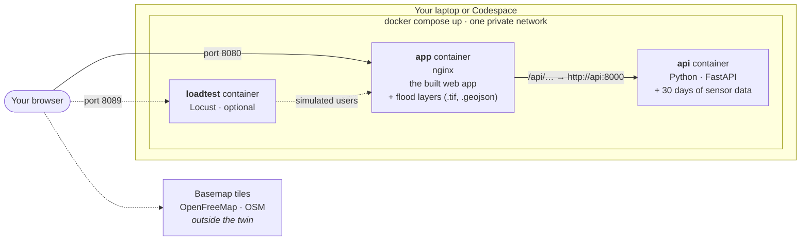

# Walkthrough

Each step ends with a git tag. If you fall behind, save your work and jump to the tag:

```bash
git stash                 # put your own changes aside
git checkout step-3       # continue from the end of step 3
```

---

## Before we start: where does Docker fit?

You may expect containers to come at the **end**, in Lab 7B. In fact you are inside one from the first minute.

There are two different jobs for containers:

| | **Dev container** (from step 0) | **Production image** (step 9, Lab 7B) |
|---|---|---|
| Defined in | `.devcontainer/devcontainer.json` | `api/Dockerfile`, `app/Dockerfile`, `docker-compose.yml` |
| Contains | Tools to **build** the app: Node, Python, Docker, editor extensions | Only what is needed to **run** the finished app |
| Who uses it | Developers (you, today) | The server that hosts the twin |
| Written | Before the first line of code | Once you know what you are shipping |

This is the usual order in a real team: agree on the development environment first, so everyone's machine is the same, then write the app, then package it for production. You can't write a good production image before you know what the app needs.

---

## Step 0 · An empty SvelteKit app → `step-0`

**Goal:** a web app running in your browser, served from inside the dev container.

**What was done** (you don't need to repeat it, it's already in the repo):

```bash
npx sv create app --template minimal --no-types --no-add-ons --install npm
```

This created `app/` with the smallest possible SvelteKit project.

**Try it**

```bash
cd app
npm run dev
```

Open port **5173** (Codespaces offers it in a pop-up, or use the **Ports** tab). You see *Welcome to SvelteKit*.

**Look around**

| File | What it is |
|---|---|
| `app/src/routes/+page.svelte` | The home page. Every folder in `routes/` is a URL |
| `app/src/routes/+layout.svelte` | The frame around every page |
| `app/package.json` | The app's dependencies and scripts (`dev`, `build`) |
| `.devcontainer/devcontainer.json` | The machine you are working on |

**Try:** change the text in `+page.svelte` and save. The browser updates by itself. That is the dev server's *hot reload*.

**Questions**
- `devcontainer.json` asks for Node 26, Python 3.15 and Docker. Why does the whole class get exactly the same versions?
- Which file would you change to give the app a different title in the browser tab?

---

## Step 1 · Fetch the live sensor feed → `step-1`

**Goal:** the app asks a sensor service for the latest water levels and shows them in a table.

### The pieces

```
 data/          ──▶  api/  (Python, port 8000)  ──▶  app/  (SvelteKit, port 5173)  ──▶  your browser
 30 days of          replays the data as if           asks the API, shows
 real readings       it were live                     a table
```

- **`data/`**: 30 days of real readings from 33 water-level sensors in Tambaram, unfiltered. Read `data/README.md`.
- **`api/main.py`**: a small web service (FastAPI). It pretends the recorded data is live: it starts at the 4 November rain event and plays **one hour of data per real minute**.
- **`app/`**: the web app. The browser asks the app for `/api/…`, and the app's dev server forwards it to the API (`app/vite.config.js`). The browser only ever talks to one address.

### Run it (two terminals)

Terminal 1, the sensor API:

```bash
python api/main.py
```

Terminal 2, the web app (click **+** in the terminal panel for a second terminal):

```bash
cd app
npm run dev
```

Open port **5173**. You see a table with one row per sensor. Press **Refresh** a few times: the sensor time moves on.

### Explore the API

Open port **8000** and add `/docs` to the address. FastAPI shows every endpoint, and you can try each one with **Try it out**:

| Endpoint | Returns |
|---|---|
| `/sites` | Where each sensor is, and its type |
| `/live` | The latest reading of every sensor *now* |
| `/history/TBM-16?from=…&to=…` | All readings of one sensor in a time window |
| `/health` | Is the service up, and where is the replay |

### Look at the code

| File | What to look for |
|---|---|
| `app/src/routes/+page.svelte` | `load()` fetches `/api/sites` and `/api/live`; `$state` makes the table update when the data arrives |
| `app/vite.config.js` | The `proxy` block that forwards `/api` to port 8000 |
| `api/main.py` | `data_now()`: how a recording becomes "live" |

### Questions

- Look at the **Depth** and **Age** columns. Which sensors would you trust right now? Which ones are clearly wrong, and how can you tell?
- TBM-01 shows −7.49 m measured days ago. Should the app show that number at all?
- Times in the API are in UTC seconds; the table shows IST. Why store UTC and convert only for display?
- Stop the API (Ctrl+C in terminal 1) and press **Refresh**. What does the app say? Start it again.

---

## Step 2 · MapLibre GL: sensors on a map → `step-2`

**Goal:** the same 33 sensors, now as dots on a 2D web map. Click a dot to see its latest reading.

### What was done

```bash
cd app
npm install maplibre-gl
```

| File | What changed |
|---|---|
| `app/src/lib/sensors.js` | **New.** `toGeoJSON()` turns sites + readings into GeoJSON. The time helpers moved here from the page |
| `app/src/lib/MapLibreMap.svelte` | **New.** The map component: basemap, a source, two layers, a popup |
| `app/src/routes/+page.svelte` | Builds the GeoJSON with `$derived` and puts `<MapLibreMap {geojson} />` above the table |
| `app/src/routes/+page.js` | **New.** `ssr = false`: this page is rendered only in the browser |
| `app/vite.config.js` | `optimizeDeps.exclude`: keeps MapLibre's web worker working in the dev server |

### Run it

Same two terminals as step 1. Open port **5173**: the map is above the table. Zoom in until the sensor ids appear, and click a dot.

### Three ideas to take away

**1 · GeoJSON is the common language.** The API gives us its own JSON. We turn it into GeoJSON once (`toGeoJSON`), and from then on any web map can draw it: MapLibre here, and CesiumJS or deck.gl in the optional extras at the end. Note the order: GeoJSON is **[lon, lat]**, not [lat, lon]. Swap them and Tambaram ends up in the Southern Ocean.

**2 · Source + layer.** MapLibre separates *what* from *how*:

```js
m.addSource('sensors', { type: 'geojson', data: geojson });       // what: the data
m.addLayer({ id: 'sensor-dots', type: 'circle', source: 'sensors', // how: draw it as circles
             paint: { 'circle-radius': 7, 'circle-color': '#1f6fb2' } });
```

One source can feed several layers: here a `circle` layer for the dots and a `symbol` layer for the labels. When new data arrives, we only call `setData()` on the source; every layer redraws by itself.

**3 · The basemap is someone else's server.** The grey streets come from OpenFreeMap, a free vector tile service built on OpenStreetMap. No API key, but your map now depends on it. Open your browser's developer tools (**Network** tab) and pan the map: every request to `tiles.openfreemap.org` is a piece of the basemap. In a real twin you decide whether you can live with that, or host the tiles yourself.

### Why `ssr = false`?

SvelteKit normally renders a page once on the server, then again in the browser. A web map needs things only a browser has: a canvas, WebGL, the window size. `export const ssr = false` in `+page.js` says: skip the server, render this page in the browser only.

### Try

- In `MapLibreMap.svelte`, change `circle-color` and `circle-radius`. Save and watch the map update.
- Change the style URL from `positron` to `liberty` or `bright`.
- Change `minzoom: 13` on the label layer. What happens at 10? At 16?
- Make the radius depend on the data: `'circle-radius': ['interpolate', ['linear'], ['get', 'depth_m'], 0, 5, 0.5, 15]`. What happens to the sensors with negative depths? (Step 3 deals with that properly.)

### Questions

- Every dot is the same colour. Looking only at the map, can you tell where it is flooding? What would you need?
- TBM-01 still shows −7.49 m from 12 days ago, as a dot that looks exactly like a fresh one. Is that a problem? How would you show it?
- TBM-16 and TBM-17 have exactly the same coordinates, so one dot hides the other. Which one do you see when you click? How should a map show two sensors in one place?

---

## Step 3 · Threshold colours, alert banner, hysteresis → `step-3`

**Goal:** turn numbers into decisions. Each sensor gets a level (dry, watch, warning, danger), the map and table are coloured by it, and a banner lists the sensors that need attention. Readings we can't trust are shown as such, not as water.

### What changed

| File | What changed |
|---|---|
| `app/src/lib/sensors.js` | **The rules.** `THRESHOLDS`, `HYSTERESIS_M`, `STALE_AFTER_S`, `SUSPECT_BELOW_M`, the `LEVELS` colours, and the functions `waterLevel()` and `classify()` |
| `app/src/routes/+page.svelte` | Keeps each sensor's level between refreshes, the alert banner, a legend, and **Level** and **Changes** columns |
| `app/src/lib/MapLibreMap.svelte` | Dots take their colour from the data; the most severe are drawn on top |

### Run it

Same two terminals. To land in the middle of the 4 November event straight away, start the API like this:

```bash
REPLAY_START=2026-11-04T15:00 python api/main.py
```

Press **Refresh** every few seconds (one real minute is one hour of data) and watch the banner, the colours and the **Changes** column.

### The rules, in order

`classify()` asks two questions, in this order:

1. **Can we trust this reading?** No reading for 30 minutes → *No recent data* (grey). Depth below −0.10 m, or more than the sensor's mounting height → *Suspect* (purple).
2. **Only then: how deep is it?** 0.15 m → *Watch*, 0.30 m → *Warning*, 0.50 m → *Danger*.

The order matters. Without step 1, TBM-01's −7.49 m from a week ago would simply count as "dry", and the map would look reassuring for a place we know nothing about.

The thresholds are teaching values (kerb height, cars stalling, unsafe to walk). In a real twin they come from the city's emergency plan, and may differ per site: 0.30 m in an underpass is not the same as 0.30 m on a main road.

### Hysteresis

A level that hovers around a threshold makes a nervous map. Try this in the `app/` folder:

```bash
node -e "
import('./src/lib/sensors.js').then(({ waterLevel }) => {
  let level = 'dry';
  for (const d of [0.28, 0.31, 0.29, 0.31, 0.27, 0.29, 0.24]) {
    level = waterLevel(d, level);
    console.log(d, level, '   without hysteresis:', waterLevel(d, 'dry'));
  }
});"
```

Without hysteresis the sensor jumps between *watch* and *warning* four times in seven readings; every jump could be an SMS to someone. With it, a sensor **enters** warning at 0.30 m but only **leaves** it below 0.25 m (`HYSTERESIS_M = 0.05`). To do that, `waterLevel()` needs to know the previous level. That is why the page keeps `levels` between refreshes.

### Try

- Set `HYSTERESIS_M = 0` and refresh during the event. Watch the **Changes** column.
- Set `STALE_AFTER_S` to 5 minutes. How many sensors go grey? Some sensors report every minute, others every 5 minutes.
- Give underpasses a lower warning threshold than streets. Where would that rule live?

### Questions

- TBM-33 reads above 0.5 m almost the whole month (typically about 0.75 m), also on days without rain, so it is nearly always *Danger*. Danger, or a sensor that needs recalibrating? Can the app tell the difference? Can you?
- TBM-14 is always negative, between −1 and −9 m. It is now *Suspect*. Who should be told, and how?
- The banner says how many sensors have no trustworthy data. Why put that in the banner, and not only in the table?
- Our levels are computed in the **browser**. Two people with the page open since different times can see different levels for the same sensor (hysteresis depends on history). Where should this logic live in a real system?

---

## Step 4 · Live updates and a "feed lost" indicator → `step-4`

**Goal:** the app asks for new readings by itself, and says loudly when it can't get them. A twin that shows yesterday's map as if it were today's is worse than no twin.

### What changed

Only `app/src/routes/+page.svelte`:

| Piece | What it does |
|---|---|
| `POLL_MS`, `tick()` | Ask `/api/live` every 10 s. *Pause*/*Resume* and *Update now* replace the Refresh button |
| `getJSON()` | Every request gives up after 5 s (`AbortSignal.timeout`). A server that hangs counts as a failure too |
| `lastOk`, `lastError`, `feed` | The state of the feed: **connecting**, **live**, **delayed** (a request failed, but less than 30 s ago), **lost** (nothing good for 30 s) |
| Feed lost banner | Dark banner, greyed-out map, "Last known" in front of the warnings |

### Run it

Same two terminals. The dot next to the title should be green: **Live**. Leave the page alone and watch the sensor time move on.

**Now break it.** Press Ctrl+C in the API terminal and watch the page for 30 seconds:

1. After the next poll: orange, **Delayed**.
2. After 30 s: red, **Feed lost**. The map goes grey, and the warnings say *Last known*.
3. Start the API again (`python api/main.py`). Within 10 s it is green again, without reloading the page.

### Three ideas to take away

**1 · Polling: `setTimeout`, not `setInterval`.** `tick()` waits for the answer before it schedules the next request. With `setInterval`, a slow server gets a new request every 10 s whether it answered the last one or not, and they pile up exactly when the server is already struggling (during a flood, when everyone opens the map).

**2 · "No news" is not "good news".** When the feed is lost, the page never says *No flood warnings*. It says *Flood warnings unknown*. Look for that `{:else if feed === 'lost'}` in the banner. A false all-clear is the most dangerous thing a flood map can show.

**3 · Keep the last good data, but label it.** On a failure we don't clear the map; we keep the last readings and say how old they are. People can still use them, as long as they know they're old.

### Two kinds of "old"

Step 3 already has *No recent data* for a single sensor that stopped reporting. Step 4 is about the whole **feed**: the connection between your browser and the API. They are different failures with different fixes. A dead sensor needs a technician in Tambaram; a lost feed needs someone to look at the server.

### Try

- Change `FEED_LOST_AFTER_MS` to 5 s. Is the page now more honest, or just more nervous?
- Make the page stop polling when the browser tab is hidden (`document.visibilityState`). Why would 40 open laptops in a classroom care?
- Set `POLL_MS` to 1 s and open the **Network** tab in the developer tools. Now picture 10,000 residents during a cyclone. (Lab 7B comes back to this.)

### Questions

- Stop the API and start it again. The sensor time jumps **back** (the replay restarts). The app accepts the older data without a word. In a real feed, when can older data arrive, and what should the app do?
- The API can be up while the sensors behind it are not: every answer arrives on time, but the readings stop changing. Does our *Live* dot catch that? How would you detect it?
- The status says "/api/live answered 502". Is that a good message for a duty officer at 3 a.m.? What would you write instead?

---

## Step 5 · Pages, one shared feed, switchable layers → `step-5`

**Goal:** turn the demo into an app. The map gets its own page, the sensor table gets a page of its own, and the sensors become one **information layer** among others to come, switched on and off in a layer panel.

### The new shape

```
                      +layout.svelte   header, navigation, feed status, banners
                      │  starts the feed once ──▶ feed.svelte.js  (polls /api/live every 10 s)
                      │
          ┌───────────┴──────────────┐
      /maplibre                   /sensors
      MapLibreMap                 the table
      inside MapPage: map + LayerPanel ──▶ layers.svelte.js
```

| File | What it is |
|---|---|
| `app/src/lib/feed.svelte.js` | **New.** The sensor feed: data, levels, polling, feed status. Moved out of the page |
| `app/src/lib/layers.svelte.js` | **New.** The list of information layers and whether each is on |
| `app/src/lib/LayerPanel.svelte` | **New.** The *Layers* box with a checkbox per layer, and the legend |
| `app/src/lib/MapPage.svelte` | **New.** The frame of every map page: the map, the layer panel, grey when the feed is lost |
| `app/src/routes/+layout.svelte` | Header with navigation and feed status, the banners, and `feed.start()` |
| `app/src/routes/maplibre/+page.svelte` | **New.** The map page: a few lines |
| `app/src/routes/sensors/+page.svelte` | **New.** The sensor table |
| `app/src/routes/+page.js` | The home address now sends you to `/maplibre` |
| `app/src/routes/+layout.js` | `ssr = false` for the whole app (was one page) |
| `app/src/lib/MapLibreMap.svelte` | Takes a `layers` prop and hides the sensors when they are switched off. Now fills its page |

### Run it

Same two terminals. Open port **5173**: you land on **MapLibre GL**. Switch pages with the navigation bar. Untick **Water-level sensors** in the *Layers* box, open **Sensor data**, and come back: the sensors are still off. The choice lives in `layers.svelte.js`, not in the page.

### Three ideas to take away

**1 · State that outlives a page belongs in a store.** In step 4 the page did the polling. With several pages, that would mean four pollers, or a feed that restarts (and forgets its hysteresis history, step 3) every time you change page. `feed.svelte.js` holds **one** feed. The layout starts it, and because the layout stays mounted while you move between pages, it keeps running. Every page imports the same `feed` object. Check: open **Sensor data**, then a map, then back: the *Changes* column has kept counting.

**2 · `.svelte.js` files.** `$state` and `$derived` also work outside components, in files whose name ends in `.svelte.js`. In `feed.svelte.js` they sit on a class: `feed.status` and `feed.geojson` recompute by themselves when the data changes, on every page that uses them.

**3 · A layer is data + "how to draw it" + "is it on?".** `layers.svelte.js` only says *which* layers exist and whether they are on. The map component decides how to draw and hide it: in MapLibre, `setLayoutProperty(id, 'visibility', 'none')` on each style layer. Another map engine would do the same job in its own way (see the extras at the end).

### Adding a layer

The next information layers for a flood twin could be rain gauges, drains, flood-prone areas or a flood-depth map. For each one:

1. Add it to `layers.svelte.js`: `drains: { label: 'Storm-water drains', visible: false }`.
2. Get its data (an API endpoint, or a GeoJSON file in `app/static/`).
3. In the map component: draw it, and follow `layers.drains.visible`.

The layer panel picks it up by itself.

### Try

- Add a layer entry with no data behind it yet. What does the panel show? What do the maps do?
- Open the browser's developer tools on the **Network** tab and move between pages. How many `/api/live` requests do you see every 10 s?
- Reload the browser on `/sensors`. Which settings survive a reload, and which don't? Why?

### Questions

- The map page is only a few lines long. What would it take to add a second map engine (for example CesiumJS, or OpenLayers)? The extras at the end do exactly that.
- The layer choices are lost when you reload. Should they be kept: in the URL, in the browser, or on the server? What does each choice mean for sharing a link with a colleague?
- The feed is still computed in each browser (levels, hysteresis). Now that the app has pages and layers, is it time to move that to the server? What would change in Lab 7B?

---

## Step 6 · Sensor details: a day and a month in the popup → `step-6`

**Goal:** click a sensor on the MapLibre map and get its story, not only its latest number: **Now**, the last **Day** and the last **Month**, as tabs in the popup.

### What changed

| File | What changed |
|---|---|
| `api/main.py` | **New endpoint** `/history/{site}/hourly`: one summary per hour (min, mean, max, count), up to 31 days |
| `app/src/lib/SensorChart.svelte` | **New.** A small time-series chart in plain SVG, with the step 3 thresholds as dashed lines |
| `app/src/lib/SensorDetail.svelte` | **New.** The popup content: three tabs, loads the history when a tab is first opened |
| `app/src/lib/MapLibreMap.svelte` | The popup now holds a Svelte component instead of a fixed piece of HTML |

Restart the API after pulling this step: it has a new endpoint.

### Run it

Same two terminals. On the **MapLibre GL** page, click a sensor. Switch between **Now**, **Day** and **Month**. Leave the popup open on **Now**: the value keeps updating with the feed.

Try TBM-15 (a real event), TBM-22 (high all month: flood or offset?), TBM-14 (always negative: the chart says so).

### Three ideas to take away

**1 · Don't send what you can't show.** A month of one-minute readings is about 43,000 points per sensor. A 300-pixel-wide chart can't show them, and the phone of a field engineer shouldn't download them. So the **server** summarises: one row per hour with the lowest, mean and highest reading. The Day view uses the raw readings (`/history`, ~1,400 points); the Month view uses the summary (`/history/…/hourly`, ~720 rows). Choosing the right resolution per view is a design decision, not a detail.

**2 · Summaries can hide things.** The hourly *mean* of a sensor that jumps between 0.5 m and −0.3 m looks calm. That's why the Month chart also draws each hour's **range** as a bar. Which number would you put in a report: the mean or the max?

**3 · A map popup can hold a whole component.** MapLibre only knows HTML elements. `mount(SensorDetail, { target, props: { id } })` puts a live Svelte component into an empty `<div>`, and `unmount()` removes it when the popup closes. Because the component reads the shared `feed`, the **Now** tab stays live.

### Load on demand, again

The history is fetched only when you open the **Day** or **Month** tab, and only once per popup. Open the **Network** tab in the developer tools and watch when the requests go out. Don't download what nobody looks at: the flood layers in the next step follow the same rule.

### Try

- Add a **Week** tab. Which endpoint would you use, raw or hourly?
- In `SensorChart.svelte`, change `gap_s`. What happens to the gaps in TBM-03's line?
- Draw the hourly **max** instead of the mean as the line.

### Questions

- The chart cuts off readings below −0.5 m and says so underneath. Is it better to cut them off, show them, or hide them?
- The summaries are computed on every request. With 10,000 users clicking sensors during a cyclone, what would you change? (Lab 7B.)
- The Day view starts 24 hours before the replay's "now". After an API restart (step 4), what happens to a popup that is already open?

---

## Step 7 · A flood scenario: one raster, one vector → `step-7`

**Goal:** show that a twin is more than sensors. Add two layers from a flood **model**, a 100-year scenario: the maximum water depth as a **raster**, and the buildings it reaches as a **vector** layer. Both start switched off in the *Layers* box.

### What was done

```bash
cd app
npm install @geomatico/maplibre-cog-protocol
```

| File | What changed |
|---|---|
| `app/static/layers/max_depth_100yr.tif` | **New.** The raster for the map: max flood depth, prepared for the browser (see `data/README.md`) |
| `data/flood/max_depth_100yr_utm.tif` | **New.** The same max depth, untouched, on the model's own grid: open it in QGIS |
| `app/static/layers/buildings_exposure.geojson` | **New.** The vector: 14,188 buildings with at least 0.15 m of water |
| `app/src/lib/scenario.js` | **New.** How to draw both, the depth colours, reading a depth at a click |
| `app/src/lib/layers.svelte.js` | Two new entries: `buildings` and `flood` |
| `app/src/lib/LayerPanel.svelte` | A legend per layer; layers a page can't draw are greyed out |
| `app/src/lib/MapLibreMap.svelte` | Adds the layers the first time they are switched on; clicks on buildings and on the flood map |

### Run it

Same two terminals. On the **MapLibre GL** page, tick **Max flood depth** and **Buildings exposed** in the *Layers* box. Zoom in. Click a building, then click a blue area away from buildings.

### Raster and vector, side by side

| | Raster: flood depth | Vector: buildings |
|---|---|---|
| What it is | A grid: one number per 10 m cell | Shapes, each with properties |
| File | Cloud-Optimized GeoTIFF (1.9 MB) | GeoJSON (4.1 MB) |
| How it reaches the map | The plugin reads only the parts of the file it needs (HTTP **range requests**) and turns them into tiles in the browser | MapLibre downloads the whole file once |
| Colour | `colourDepth()` in `scenario.js`, called for every pixel | A style rule on `depth_m`, like the sensors in step 2 |
| Click | `locationValues()` reads the number in the file at that spot | The feature's properties |

**1 · Static files, no server.** Both layers are plain files in `app/static/`, served like an image. No tile server, no database. Open the **Network** tab, switch on the flood layer, and pan: you'll see requests for the *same* `.tif` file, each with a `Range:` header asking for a different piece of it. That is what "cloud-optimized" means.

**2 · The same thresholds everywhere.** Buildings are coloured with the sensors' levels from step 3 (*Watch* 0.15 m, *Warning* 0.30 m, *Danger* 0.50 m). A red building and a red sensor mean the same thing. The raster uses blues instead, because it shows depth itself, not a decision.

**3 · Model vs measurement.** The sensors say what the water **is** doing. The scenario says what it **could** do in a 1-in-100-year event. Put them on one map and the questions start: is the scenario's 0.84 m near a sensor plausible? Did any sensor ever see that?

### Overviews: why the click reads at full resolution

A COG contains the data several times: full resolution, plus smaller copies (**overviews**) for zoomed-out views. When you zoom out, the plugin draws from an overview, which is fast but coarse. For a **click** we always ask for the full-resolution value (`floodDepthAt` in `scenario.js`). At zoom 12, an overview can give 0.21 m where the real value is 0.84 m.

### How the files were made

From the model's 119 time steps: the highest value per cell (the *maximum* depth), cells below 0.05 m dropped, reprojected to Web Mercator and written as a COG with GDAL. Building outlines from OpenStreetMap; for each building, the deepest cell it touches. The script is not in this repository, but every step is a standard GDAL or GeoPandas operation.

### Try

- Open `data/flood/max_depth_100yr_utm.tif` in QGIS next to the web version. Where do they differ, and why? (Projection, rounding, the thin film below 0.05 m.)
- In `scenario.js`, change the depth classes in `DEPTH_CLASSES`, or start the colours at 0.15 m instead of 0.05 m. How much of the map stays blue?
- Change `raster-opacity`. Can you still read the streets?
- Colour the buildings by the raster's blue classes instead of the sensor levels. Which version would you show a city official?

### Questions

- 14,188 buildings are exposed. How many of them are homes, and how many are schools or hospitals? Can this data tell you? What would you need?
- **Exposure is not damage.** What does an impact model such as Delft-FIAT add on top of this layer? (Hint: depth-damage curves, building values, people.)
- The scenario is a static file; the sensors are live. Which of the two would you trust in the middle of a real flood, and for which decision?
- The raster is 1.9 MB for one scenario and one variable. The RHT platform serves many scenarios, time steps and variables. Static files, or a tile server such as TiTiler? (Lab 7B.)

---

## Step 8 · The flood over time: a time slider → `step-8`

**Goal:** show the flood as it happens, not only its worst moment. A **multi-temporal raster** (one layer per moment) and a **slider** to move through the event, with a play button.

### What changed

| File | What changed |
|---|---|
| `app/static/layers/depth_timeseries_100yr.tif` | **New.** The 100-year scenario hour by hour: 119 moments, one band each (see `data/README.md`) |
| `app/static/layers/depth_timeseries_100yr.json` | **New.** Which model step each band is, the hour between steps, and how much area is wet |
| `app/src/lib/FloodTimeBar.svelte` | **New.** The time bar along the bottom of the map: play button, slider with hour ticks, and the wet area through the event |
| `app/src/routes/maplibre/+page.svelte` | Shows the time bar while the layer is on |
| `app/src/lib/scenario.js` | Draws the time series; shows the band chosen on the slider; the depth at a click, at that moment |
| `app/src/lib/layers.svelte.js` | A new layer, `floodTime`, with the slider position in `band`. The two flood layers form a **group** (`GROUPS`) |
| `app/src/lib/LayerPanel.svelte` | A group is one choice: **None**, **Maximum depth** or **Over time**, with one legend for both |
| `app/src/lib/MapLibreMap.svelte` | Adds the layer the first time it is chosen |

### Run it

Same two terminals. On the **MapLibre GL** page, choose **Over time** under *Flood depth* in the *Layers* box. A time bar appears along the bottom of the map: press ▶ to play the event (about 30 seconds), or drag the slider. **Time 0:00** is the start of the model run; every step is one hour. Click the map to read the depth at that place, at that moment.

Watch the chart above the slider: the wet area jumps from 3.4 km² to 10.4 km² between Time 26:00 and 27:00, peaks at about 40 km² at Time 59:00, and is still 31 km² at Time 118:00. The water arrives within hours and leaves over days.

### One flood at a time

*Maximum depth* and *Over time* are two views of the same flood, with the same colours. Both on at once would put two blue maps on top of each other, and nobody could tell which blue is which. So the *Layers* box offers them as **one choice**: none, one or the other. In `layers.svelte.js` they stay two layers, each with its own `visible`; the panel just makes sure only one is on (`choose()` in `LayerPanel.svelte`).

### Three ideas to take away

**1 · One file, many moments.** The 119 hours are 119 **bands** of one GeoTIFF, like the red, green and blue bands of a photo. The slider only chooses which band to colour (`colourDepthAtStep` in `scenario.js`). Each piece of the file holds all 119 hours for its area, so after the first view, moving the slider downloads nothing: open the **Network** tab and check.

**2 · Store centimetres, compute in metres.** The RHT platform stores flood depth as whole centimetres in 16-bit integers (`uint16`, 0 to 65,534 cm, with 65535 = no data). As decimal metres the file would be about four times larger; as centimetres it is **16.9 MB** for all 119 hours. A *scale factor* of 0.01 in the file tells QGIS and GDAL to show metres. In our code the colour function gets the raw centimetres and divides by 100; the click function gets metres directly, because the plugin applies the scale factor for it.

**3 · Reprojection is not innocent.** Turning the model's 10 m UTM cells into Web Mercator moves cell edges a little, and every tool makes small choices: which neighbouring cell to take, whether to interpolate. Interpolating *depths* invents values that were never modelled. We use nearest neighbour and an exact transformation for every flood file, so the time series and the max-depth map pick the same cell everywhere. We checked: on all 511,670 wet pixels, no moment is deeper than the maximum.

### Try

- In `FloodTimeBar.svelte`, change the play speed (`250` ms per hour).
- Switch between **Maximum depth** and **Over time** at the peak (Time 59:00). Where is the maximum already reached, and where does the water come later?
- With the buildings layer on, play the event. When do the first red buildings get wet?

### Questions

- The slider counts hours from the start of the model run. What would you need to show real clock times (*Tuesday 14:00*), and why does that matter for an evacuation decision?
- The model wrote one output per hour. What might happen *between* two outputs that the map can't show? When would you want them every 10 minutes, and what would that cost in file size?
- The scenario is a *what if*; the sensors are *what is*. How would you start a forecast like this one from the sensors' readings right now? (Day 7 morning: AI surrogates.)

---

## Step 9 · The whole twin in containers → `step-9`

**Goal:** package the twin so that *anyone* can run exactly what you built, with one command, on any machine with Docker: a colleague's laptop, a server, the cloud. This is Lab 7B.

### The setup



Two containers make the twin; a third one is optional:

| Service | Image | What it does | Reachable from outside? |
|---|---|---|---|
| `api` | `flood-twin-api:1.0`, from `api/Dockerfile` | The sensor API, with the data inside the image | **No.** Only the `app` container can reach it, by its name `api` |
| `app` | `flood-twin-app:1.0`, from `app/Dockerfile` | nginx: serves the built app and the flood layers, passes `/api/…` on to `api` | Yes, port **8080** |
| `loadtest` | `locustio/locust` | Simulates many users (optional, see below) | Port **8089** |

### What changed

| File | What it is |
|---|---|
| `docker-compose.yml` | **New.** The whole twin as services |
| `api/Dockerfile` | **New.** The API image: Python, the packages, the code **and the data** |
| `app/Dockerfile` | **New.** Two stages: Node.js **builds** the app, nginx **serves** it |
| `app/nginx.conf` | **New.** What the Vite dev server did in development: serve the app, forward `/api` |
| `.dockerignore`, `app/.dockerignore` | **New.** What Docker may *not* copy into a build (`node_modules`, …) |
| `loadtest/locustfile.py` | **New.** The optional load test |
| `app/vite.config.js` | `adapter-static`: the app is built into plain files |
| `app/src/lib/maplibre-worker.js` | **New.** Tells MapLibre where its worker file is in the production build |
| `.devcontainer/devcontainer.json` | Forwards ports 8080 and 8089 too |

### Run it

Stop the two terminals from the earlier steps (Ctrl+C), then:

```bash
docker compose up --build
```

The first build takes a few minutes. When the log goes quiet, open port **8080**: the same app, now served from containers. Stop it with Ctrl+C.

In a second terminal, look around:

```bash
docker compose ps                  # the running services and their health
docker compose logs api            # the API's output
docker images | grep flood-twin    # the two images you built, and their size
```

### Dev container vs production images

Remember the table at the top of this walkthrough? Now you have both:

| | Dev container (step 0) | Production images (now) |
|---|---|---|
| Contains | Node, Python, Docker, editor tools: everything to **build** | Only what is needed to **run** |
| Web app | The Vite dev server, with hot reload | nginx + 24 MB of built files: a **124 MB** image. The Node.js build stage, with its `node_modules`, is thrown away |

### Three ideas to take away

**1 · The image is the machine.** "It works on my machine" is not reproducible; an image is. `api/Dockerfile` even puts the **data** inside the image, so everyone who runs `flood-twin-api:1.0` replays exactly the same 30 days.

**2 · Only expose what must be exposed.** The `api` service has no `ports`. Nobody outside can reach it; only nginx can, over Compose's private network, using the name `api`. One public door instead of two.

**3 · Development shortcuts don't survive production.** Two things that "just worked" in development broke in the production build, and both are typical:

- MapLibre's web worker was left out of the build, so the map stayed empty. Fixed in `maplibre-worker.js`.
- nginx didn't know the `.mjs` file type and sent the worker as a download; browsers refused to run it. Fixed in `nginx.conf`.

You only find these by running the real image. That is why you test the container, not just the code.

### Break it on purpose

With the twin running, in a second terminal:

```bash
docker compose stop api      # the API is gone
```

Watch the app: *Delayed*, then *Feed lost* after 30 s (step 4). Then:

```bash
docker compose start api
```

Within about 10 s the app is *Live* again, without reloading the page and without restarting nginx (see the `resolver` line in `nginx.conf`). If the API **crashes** instead of being stopped, `restart: unless-stopped` starts it again by itself.

### Caching: who has the latest file?

nginx tells browsers how to cache the flood layers, in `nginx.conf`: `Cache-Control: no-cache`. Despite its name, that does not stop caching: the browser keeps its copy, but asks each time "has this changed?". If not, nginx answers **304 Not Modified** without sending the file again, which is almost free.

We learned this the hard way. At first the setting was `max-age=3600`: "keep it for an hour without asking". Then we replaced a layer file under the **same name**, and browsers that had seen the old one kept showing it for up to an hour. The server was right; the browsers were out of date. The other common fix is to put a version in the file name (`depth_timeseries_v2.tif`), so a new file gets a new address.

The COG files get an even stricter rule: `no-store`, keep no copy at all. With an old copy, the browser asks for a *piece* of the file "only if it hasn't changed" (an `If-Range` request). After a rebuild of the container, the file has a new version tag, so nginx answers with the **whole** file instead of the piece, and the COG plugin can't use that: the flood layer stays empty until the next reload. We only found this by rebuilding and reloading many times.

See the headers for yourself:

```bash
curl -I http://localhost:8080/layers/depth_timeseries_100yr.json
curl -I http://localhost:8080/layers/depth_timeseries_100yr.tif
```

### Optional: how many people can it take?

```bash
docker compose --profile loadtest up --build
```

Open port **8089** (Locust). Each simulated user behaves like the real app: opens the page, asks for `/api/live` every 10 s, and now and then opens a sensor's Month chart. Start with 100 users, then try 1,000.

On a laptop, 200 users made 1,000 requests in 30 seconds without a single failure, typically 21 ms per request. In a Codespace (2 cores, shared with Locust itself) the numbers will be lower. What matters is which request slows down first, and why.

### Try

- Limit the API to half a CPU: add `cpus: 0.5` under `api:` in `docker-compose.yml`, run `docker compose up -d`, and run the load test again.
- Start the twin at the 6 November event: `REPLAY_START=2026-11-06T00:00 docker compose up`. Follow that setting from the command line to the code.
- Change a line in `api/main.py` and rebuild. Which build steps say `CACHED`, and why?

### Questions

- The data is inside the API image. What changes when the data is updated every day? Where else could it live?
- The twin is now two images. How would a colleague in Dresden run it without your laptop? (Hint: an image registry.)
- One machine runs everything. When would that no longer be enough, and what would you need then? (The lecture's last slides: scaling, Kubernetes, and what they cost.)

---

## Extras · two more map engines

Done early? Two optional branches add a second map engine, each as one extra page on top of the finished twin (`step-9`). They change nothing else, so you can compare engines on the same data.

| Tag | Adds | Walkthrough |
|---|---|---|
| `extra-cesium` | A **CesiumJS** page: the sensors as columns on a 3D globe | In `STEPS.md` on that tag |
| `extra-deck` | A **deck.gl** page: 3D columns as GPU layers on a tilted MapLibre map | In `STEPS.md` on that tag |

```bash
git stash                    # put your own changes aside
git checkout extra-cesium    # or extra-deck
cd app && npm install        # the extra engine's packages
```

The Resilient Hydro Twin started on CesiumJS and moved to MapLibre when stakeholders said they didn't need 3D. Try one, and decide for yourself.

---

## Extra · CesiumJS: the same data on a 3D globe → `extra-cesium`

**Goal:** show the whole twin on a 3D globe: the sensors as columns whose height is the water depth, every building as a 3D block (the exposed ones in colour), and the flood (maximum and over time) draped on the ground. Then ask honestly: does 3D help here?

### What was done

```bash
cd app
npm install cesium
```

| File | What changed |
|---|---|
| `app/src/lib/CesiumGlobe.svelte` | **New.** The globe: imagery, camera, a column per sensor, 3D buildings, the flood rasters, a click for the depth |
| `app/src/lib/scenario.js` | `cogTile()`, `cogBounds()`, `useFloodStep()`: the COG plugin's tiles for another engine; `BUILDING_HEIGHT_M`, `buildingColour()` |
| `app/static/layers/buildings_all.geojson` | **New.** All 78,045 OpenStreetMap buildings with their flood depth (22 MB; about 3.3 MB compressed, as nginx sends it). The 2D map doesn't need it: its basemap draws the buildings |
| `app/src/lib/layers.svelte.js`, `LayerPanel.svelte` | The buildings layer is now *Buildings*, with a grey legend entry for the ones that are not exposed |
| `app/src/routes/cesium/+page.svelte` | **New.** The CesiumJS page: the same `geojson`, the same *Layers* box and time bar as the MapLibre page |
| `app/src/routes/+layout.svelte` | A **CesiumJS** link in the navigation |
| `app/src/lib/sensors.js` | `columnHeight()`: how tall a column is for a given depth |
| `app/scripts/copy-cesium.js` | **New.** Copies Cesium's workers, images and widget styles to `static/cesium-assets/` |
| `app/package.json` | `"postinstall"` runs that script after every `npm install` |
| `app/.gitignore`, `app/.dockerignore` | `static/cesium-assets/` is a copy, so it is not committed or sent to Docker |
| `app/Dockerfile` | Copies `scripts/` before `npm ci`, so the copy also happens in the image |

### Run it

Same two terminals (or Docker). After `git checkout extra-cesium`, run `npm install` in `app/` first: that installs Cesium **and** copies its files. Then open the **CesiumJS** page and switch on the layers in the *Layers* box.

- Drag to pan, scroll to zoom, **right-drag** (or Ctrl+drag) to tilt. Zoom in on a neighbourhood to see the buildings stand up.
- Click a column or a building: Cesium's info box shows it. Click the ground with a flood layer on: the depth there.
- Under *Flood depth*, choose **Over time** and press ▶ in the time bar: the flood plays on the globe.
- The globe button at the top right switches between **3D**, **2D** and **Columbus view**.

### Three ideas to take away

**1 · Same data, different engine.** `CesiumGlobe` receives exactly the same `geojson` as `MapLibreMap`. Only the drawing code differs. This is why step 2 converted the API's data into GeoJSON once, in `sensors.js`.

**2 · Two ways to say "draw this".** Compare:

| | MapLibre (step 2) | Cesium (this extra) |
|---|---|---|
| Model | A source and **style rules** for layers | One **entity** per object |
| Colour | `'circle-color': ['get', 'colour']`: a rule, applied to all features | `e.cylinder.material = …`: set on each entity |
| New data | `setData(geojson)`, done | Loop over the features and update each entity |

Style rules scale to thousands of features. Entities are easier to reason about, one object at a time, and give you a 3D shape per object.

**3 · Big libraries are loaded on demand.** Cesium is several megabytes. `await import('cesium')` inside `onMount` means the browser only downloads it when someone picks the globe. Open the **Network** tab, reload, and see when the Cesium files arrive.

### The flood layers: same file, same plugin, another engine

Cesium can't read our Cloud-Optimized GeoTIFFs by itself. But it asks for map **tiles** (x, y, zoom), just like MapLibre does, through an *imagery provider*. `cogLayer()` in `CesiumGlobe.svelte` makes a provider that hands each request to the same COG plugin (`cogTile()` in `scenario.js`). So the globe shows the **same files**, with the **same colours** and the **same time step** as the MapLibre page, and nothing was converted. That is the point of an open, tiled format: any engine that speaks "tiles" can use it.

### 3D buildings: why so plain?

The buildings are all 78,045 OpenStreetMap footprints in the area, raised into blocks: the 14,188 exposed ones in their depth colour, the rest grey, so the flooded streets sit in a real city. Every block is **6 m tall** (`BUILDING_HEIGHT_M`, about two storeys), because OpenStreetMap almost never says how tall a building is here: 5 of the 78,045 buildings in the area have a height, and 160 (0.2%) a number of floors.

Ready-made 3D city layers exist, but none without strings attached:

| Layer | What it needs |
|---|---|
| **Cesium OSM Buildings** (worldwide, from Cesium) | A free Cesium ion account and an access token |
| **Google Photorealistic 3D Tiles** | A Google API key with billing |
| Our own footprints, raised (this extra) | Nothing, but every building is the same height |

A token in a public repository can be copied and misused, so every participant would need their own account. For a class we chose the plain blocks. For a real twin, the building heights (from a survey, LiDAR, or the drone flights on Day 8) are worth a lot more than a nicer viewer.

### 78,045 buildings: entities or one primitive?

The sensor columns are **entities**: one Cesium object per sensor, easy to update and click. That is fine for 33 sensors. For 78,045 buildings it is far too slow and too heavy. So `loadBuildings()` describes each building as a *geometry instance* and hands them all to **one primitive**: Cesium builds the shapes in background workers (`asynchronous: true`) and draws them all in one go. The buildings appear a few seconds after you switch them on.

The price: a building is no longer an entity, so Cesium can't show its info box by itself. `probe()` picks the building under the mouse, reads its properties (the `id` we gave each instance) and opens the info box for it. Easy things become a little harder when you optimise; that trade-off is everywhere in 3D.

### Why the extra copy script?

MapLibre is one JavaScript file plus a worker. Cesium also needs hundreds of plain files at run time (web workers, images, fonts, CSS) and looks for them at `CESIUM_BASE_URL`. SvelteKit serves everything in `static/` as-is, so we copy them there. Every project that uses Cesium solves this somehow; a small script is the most transparent way.

The folder is called `cesium-assets`, not `cesium`, on purpose: `/cesium` is the address of the CesiumJS **page**. With a folder of the same name, nginx would find the folder first, and reloading the page (or sharing its link) would fail. In development you don't notice, because the dev server checks pages first.

### No API key, but…

Cesium's own defaults (world imagery, terrain, the place-search box) come from **Cesium ion**, which needs an account and a key. We switched those off and use OpenStreetMap's raster tiles instead. Their [tile usage policy](https://operations.osmfoundation.org/policies/tiles/) is fine for a class, not for a public app with many users. Check in the **Network** tab: no request goes to `cesium.com`.

OpenStreetMap's standard map is colourful, and so is our data: blue water, yellow, orange and red buildings. So the globe restyles the basemap itself, in `BASEMAP_STYLE` at the top of `CesiumGlobe.svelte`: no colour (`saturation: 0`), lighter, less contrast. Cesium can do that to any imagery layer, and the result looks like the light grey basemap of the MapLibre page. A ready-made light basemap (CARTO, Stadia, Esri) would need an API key or a check of its terms of use.

### Try

- Change `METRES_PER_METRE_OF_WATER` to 100, then to 5000. Which one tells the truth? Which one is useful?
- Switch to **2D** with the globe button. Is this better or worse than MapLibre?
- Set `BASEMAP_STYLE` back to `{}` (OSM's own colours). Can you still read the flood and the buildings?
- Change `BUILDING_HEIGHT_M` in `scenario.js` to 20. Does the map look more real? Is it more true?
- Tilt the view almost flat. Which sensors disappear behind others?

### Questions

- A 0.94 m column is drawn 940 m tall, next to buildings drawn 6 m tall. Is that a lie? When is exaggeration acceptable on a map?
- With 0.8 m of water around a 6 m block, what do you learn from the 3D view that the 2D map didn't tell you? What would you need to see *inside* the building (ground floor, basement)?
- Compare both engines for the job *"Where should the pumps go in the next hour?"*. What does 3D add? What does it cost (download size, laptop battery, the time it takes to find a street)?
- The Resilient Hydro Twin started on Cesium, and moved to MapLibre after stakeholders said they didn't need 3D. Having tried both: would you have made the same decision for Tambaram? When would you go back to 3D?
